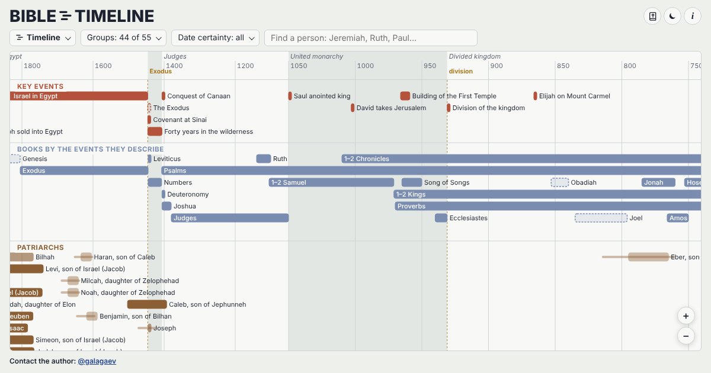

# Bible Timeline

**3,548 people and 778 events, from Adam to the present day: everyone named in the Bible, and key figures of Christianity.**

An interactive Bible timeline: prophets, kings of Israel and Judah, apostles, judges, women of the Bible, genealogies from Adam to Jesus, maps of journeys and empires, church history and world rulers — all on one time scale.

**Website:** https://galagaev.github.io/bible-timeline/  ·  Русская версия: https://galagaev.github.io/bible-timeline-rus/

## Features
- **Timeline** — everyone named in the Bible and key events, with years of ministry, reign and life.
- **Map** — places of events, journeys of Paul and others, borders of states by year.
- **Genealogy** — lines from Adam to Jesus (Matthew and Luke), kings, high priests, the twelve tribes.
- **Paradoxes of time** — surprising comparisons between eras.
- **Meanwhile** — who else lived in the chosen years.
- **Bible reader built in** — King James Version.

## Sources
Theographic Bible Metadata (CC BY-SA 4.0), BibleHub, Easton's Bible Dictionary (public domain), Cliopatria / Seshat (CC BY 4.0), Natural Earth.

Author: [@galagaev](https://t.me/galagaev)
